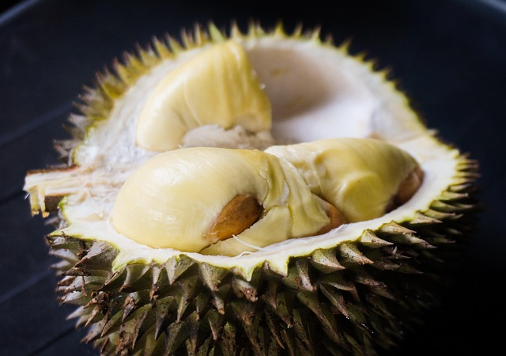

# jev-on-durians

Testing system one models on a durian data set (slightly useful)

Photo: najibzamri / Pixabay

## What is this?

In September 2026, a start-up called TypeSafe AI released **Jev** - an AI model that can't write a
single sentence. It reads a text and answers typed questions about it (yes or no, pick one, score it
on a scale) with probabilities instead of words. TypeSafe calls it a "System One" model, after the
fast, intuitive thinking in Kahneman's *Thinking, Fast and Slow*. Within weeks, OpenAI shipped a
Decisions API, and open models such as **Kev** started running on laptops through Ollama.

The promise: LLM-level judgment for a fraction of the cost and time. This repo checks that promise
on something nobody is neutral about - **durians**. We collected 83 real opinions about three famous
varieties - **Musang King** (Mao Shan Wang), **Black Thorn** and **Red Prawn** - from English,
Chinese and Malay blogs, forums and news, and asked every model the same 18 questions about each one.

Two battles:

1. **The model battle** - decision models (Jev, OpenAI's Decisions API, Kev and other local models)
   against ordinary LLMs: accuracy, time and money.
2. **The durian battle** - a Durian Elo built from the opinions: which durian wins, and do the cheap
   models crown the same king as the people did?

The notebook is also a tutorial: it shows, step by step, how to call each of these APIs. The story
behind it: the szia.ai article *Decision Models Don't Decide* (link coming).

## Repository layout

| Path | What |
|---|---|
| `the_durian_notebook.ipynb` | the tutorial and the experiment |
| `src/schema.py` | the 18 questions from `config/durian.yaml` and the three payload shapes (System One, Decisions API, pydantic) |
| `src/benchmarking.py` | the solution registry, the raw calls, the `.cache/` cache, the runner, costs |
| `src/metrics.py`, `src/elo.py`, `src/charts.py`, `src/report.py` | accuracy / time / money, the Durian Elo, the six charts, the README writer |
| `prompts/` | the LLM system prompt (`PROMPT_VERSION` header) |
| `config/durian.yaml` | the 18 questions asked about every opinion |
| `config/prices.yaml` | the list prices used for the cost columns |
| `data/durian_opinions.csv` | the dataset (83 opinions, labels, sources) |
| `results/` | `answers.csv`, `metrics.csv`, `elo.csv` and `summary.md` of the last full run (`results/smoke/` for a smoke run) |
| `tests/` | offline pytest suite with made-up fixtures |
| `assets/` | images and the result charts (`assets/charts/`) |

## Installation

- Python 3.14 with [uv](https://docs.astral.sh/uv/): `uv venv --python 3.14.5 .venv`,
  `source .venv/bin/activate`, `uv pip install -e ".[dev]"` (no lock file: never `uv lock` or `uv sync`)
- `cp .env.example .env` and fill in the keys you have (see below); `pre-commit install` for ruff
- Ollama 0.40.4 or later for the local models (see below)
- Checks: `uv run --no-sync ruff check . && uv run --no-sync ruff format --check .` and
  `uv run --no-sync pytest -q` (offline, made-up fixtures)

## Accounts and API keys

> _Placeholder - details and screenshots later._

| Service | Needed for | Registration | Variable in `.env` |
|---|---|---|---|
| TypeSafe | Jev | create an account and an API key at console.typesafe.ai | `TYPESAFE_API_KEY` |
| OpenAI | the Decisions API, GPT-6 Luna, GPT-5.6 Terra | an API account with billing at platform.openai.com | `OPENAI_API_KEY` |
| Anthropic (optional) | a bigger reference model for the score questions | an API key at console.anthropic.com | `ANTHROPIC_API_KEY` |
| Ollama | all local models | none | `OLLAMA_HOST` (optional, default `http://localhost:11434`) |

## Local models with Ollama

> Tested with Ollama 0.40.9 on a MacBook Air (Apple M2, 24 GB): Kev-4B, Clef Flash-9B, Laya and the
> local LLM all run. The decision models answer through `/v1/systemone` (Kev needs Ollama 0.40.4,
> Laya 0.40.0, Clef Flash 0.35.1). On this fanless laptop the 9B models are slow - see the p50
> column in the results; a GPU box or a smaller tag such as `kev:0.8b-q8_0` is far faster. The
> notebook picks the local LLM tag from `ollama list` (Qwen 3.5, then Gemma 4, then Qwen 3) and
> says which one it used.

All local decision models answer through Ollama's `/v1/systemone` endpoint, which follows Jev's API -
the same request works for Jev in the cloud and for the models on your laptop.

| Model | Pull | What it is |
|---|---|---|
| Kev 4B | `ollama pull kev:4b-q8_0` | open decision model by Jared Palmer (Qwen3.5 + LoRA + a small pointer head) |
| d1 | `ollama pull d1` | Liquid AI's decision model, 3B |
| tev1 | `ollama pull tev1:4b` | Together AI's decision model, 4B |
| Clef Flash | `ollama pull clef-flash` | Cloudflare's decision model, 9B (Qwen3.5-9B fine-tune, text and images) |
| Laya (optional) | `ollama pull laya` | a 421M encoder-based decision model (English) |
| Nimble (optional) | `ollama pull nimble` | Bespoke Labs' decision model, 9B |
| Qwen 3.5 (local LLM) | `ollama pull qwen3.5:9b` | an ordinary LLM with structured output, as a baseline (any Qwen 3.5 / Gemma 4 / Qwen 3 tag works; this run used `qwen3:8b`) |

## Running the notebook

Open `the_durian_notebook.ipynb` (`uv run --no-sync jupyter lab`), set `SMOKE = True` for a
five-opinion test run, then `False` for all 83. API answers are cached in `.cache/` (one JSON per
call), so re-runs cost nothing; `FORCE_RERUN = True` calls everything again. Headless:
`uv run --no-sync jupyter nbconvert --to notebook --execute the_durian_notebook.ipynb --output the_durian_notebook.smoke.ipynb`.
A full run writes `results/`, `assets/charts/` and the results section below; a smoke run writes
`results/smoke/` and leaves the README alone.

## The data

`data/durian_opinions.csv` holds 83 short opinions (29 Musang King, 28 Black Thorn, 26 Red Prawn) in
English, Chinese and Malay, quoted from 56 public pages between 2009 and 2026, with the labels used
for scoring. The quotes are short excerpts; every row links to its source, and the copyright stays
with the original authors. A full description of the columns and the labelling rules will move into
a data card here (_placeholder_).

## Results

<!-- RESULTS:START -->
_Measured on 83 opinions, 2026-10-24 10:14 +08 (mode: full); local models ran on MacBook Air, Apple M2, 24 GB, Ollama 0.40.9._

**Part 1 - accuracy, time, money** (headline = mean of aspects F1, sentiment accuracy, compares F1 and variety accuracy; prices from `config/prices.yaml`; local models cost nothing per call):

| # | solution | family | headline | aspects F1 | sentiment acc | compares F1 | preferred acc | variety acc | p50 s | p95 s | USD run | USD / 1M opinions |
|---|---|---|---|---|---|---|---|---|---|---|---|---|
| 1 | Claude Opus 5.5 (reference) | reference LLM | 0.95 | 0.95 | 0.88 | 0.98 | 0.95 | 0.97 | 5.06 | 8.47 | 1.7820 | 21469.40 |
| 2 | GPT-6 Luna (LLM) | LLM, cloud | 0.93 | 0.95 | 0.86 | 0.96 | 0.55 | 0.97 | 3.12 | 4.09 | 0.0073 | 88.10 |
| 3 | GPT-5.6 Terra (LLM) | LLM, cloud | 0.92 | 0.93 | 0.86 | 0.93 | 0.59 | 0.97 | 2.31 | 4.36 | 0.4128 | 4973.83 |
| 4 | Jev (TypeSafe) | decision, cloud | 0.87 | 0.90 | 0.76 | 0.88 | 0.73 | 0.93 | 0.30 | 0.45 | 0.0059 | 71.51 |
| 5 | OpenAI Decisions (GPT-6 Luna) | decision, cloud | 0.85 | 0.85 | 0.76 | 0.86 | 0.50 | 0.93 | 0.51 | 0.78 | 0.0264 | 317.59 |
| 6 | Clef Flash-9B (Cloudflare, Ollama) | decision, local | 0.84 | 0.89 | 0.64 | 0.89 | 0.59 | 0.95 | 31.10 | 35.17 | 0.0000 | 0.00 |
| 7 | Kev-4B (Ollama) | decision, local | 0.79 | 0.85 | 0.52 | 0.83 | 0.55 | 0.95 | 7.47 | 8.06 | 0.0000 | 0.00 |
| 8 | qwen3:8b (local LLM, Ollama) | LLM, local | 0.50 | 0.69 | 0.57 | 0.71 | 0.50 | 0.03 | 18.69 | 22.89 | 0.0000 | 0.00 |
| 9 | Laya (encoder, Ollama) | decision, local | 0.43 | 0.36 | 0.60 | 0.38 | 0.23 | 0.40 | 1.34 | 1.58 | 0.0000 | 0.00 |

Accuracy by confidence bin for the decision models (confidence = the probability of the answer given; the number of gold-scored answers in brackets; LLMs give no probability and are left out):

| confidence | Jev (TypeSafe) | OpenAI Decisions (GPT-6 Luna) | Kev-4B (Ollama) | Clef Flash-9B (Cloudflare, Ollama) | Laya (encoder, Ollama) |
|---|---|---|---|---|---|
| ≥ 0.95 | 1.00 (407) | 0.96 (601) | 0.99 (93) | 0.99 (376) | 1.00 (19) |
| 0.90 - 0.95 | 0.95 (112) | 0.78 (23) | 1.00 (126) | 0.95 (108) | 0.87 (71) |
| 0.80 - 0.90 | 0.87 (100) | 0.53 (36) | 0.97 (199) | 0.87 (95) | 0.83 (272) |
| 0.70 - 0.80 | 0.66 (44) | 0.38 (21) | 0.87 (107) | 0.73 (56) | 0.66 (176) |
| 0.60 - 0.70 | 0.59 (34) | 0.50 (14) | 0.78 (79) | 0.57 (42) | 0.43 (84) |
| 0.50 - 0.60 | 0.59 (22) | 0.43 (14) | 0.50 (86) | 0.50 (30) | 0.45 (64) |
| < 0.50 | 0.14 (7) | 0.18 (17) | 0.36 (36) | 0.37 (19) | 0.33 (40) |

Accept only answers at or above a cutoff and send the rest for manual review: accuracy of the accepted answers, with the share of answers accepted in brackets:

| cutoff | Jev (TypeSafe) | OpenAI Decisions (GPT-6 Luna) | Kev-4B (Ollama) | Clef Flash-9B (Cloudflare, Ollama) | Laya (encoder, Ollama) |
|---|---|---|---|---|---|
| all answers | 0.91 (100%) | 0.88 (100%) | 0.86 (100%) | 0.89 (100%) | 0.69 (100%) |
| ≥ 0.50 | 0.92 (99%) | 0.90 (98%) | 0.88 (95%) | 0.91 (97%) | 0.71 (94%) |
| ≥ 0.60 | 0.93 (96%) | 0.91 (96%) | 0.94 (83%) | 0.92 (93%) | 0.74 (86%) |
| ≥ 0.70 | 0.95 (91%) | 0.91 (94%) | 0.96 (72%) | 0.95 (87%) | 0.79 (74%) |
| ≥ 0.80 | 0.97 (85%) | 0.93 (91%) | 0.98 (58%) | 0.97 (80%) | 0.85 (50%) |
| ≥ 0.90 | 0.98 (71%) | 0.96 (86%) | 1.00 (30%) | 0.99 (67%) | 0.90 (12%) |
| ≥ 0.95 | 1.00 (56%) | 0.96 (83%) | 0.99 (13%) | 0.99 (52%) | 1.00 (3%) |

Charts: [cost vs accuracy](assets/charts/01_cost_vs_accuracy.png), [time per opinion](assets/charts/02_time_per_opinion.png), [accuracy by question](assets/charts/03_accuracy_by_question.png), [accuracy by language](assets/charts/04_accuracy_by_language.png), [rating vs real](assets/charts/05_rating_vs_real.png), [durian elo](assets/charts/06_durian_elo.png), [time vs accuracy local](assets/charts/07_time_vs_accuracy_local.png). The Durian Elo (part 2) is in `results/summary.md`.

**Observations**

- Overall, the best low-cost LLM, GPT-6 Luna, scores higher than the best decision model: headline accuracy 0.93 against Jev's 0.87.
- Filtered by confidence, Jev comes out ahead: at a cutoff of 0.90 its accepted answers are 98 percent correct with 71 percent of all answers still accepted (97 percent at a cutoff of 0.80, with 85 percent accepted). Used with its confidence score, it works better than the LLM.
- Jev is also about ten times faster than Luna (0.3 s against 3.1 s per opinion) and slightly cheaper (USD 72 against USD 88 per million opinions at list prices).
- The OpenAI Decisions API is usable, but Jev is better on every count: accuracy, calibration, speed and price.
- Kev and Clef Flash are genuinely good open-source alternatives. Kev is faster, being the smaller model, and slightly less accurate; both let you use the confidence score the same way.
- English and Chinese are read well; Malay is a little harder for every solution.

Skipped in this run: `ollama_d1` (model not pulled (ollama pull d1)); `ollama_tev1` (model not pulled (ollama pull tev1:4b)); `ollama_nimble` (model not pulled (ollama pull nimble)).
<!-- RESULTS:END -->

## Credits

- Photo: najibzamri / Pixabay.
- Opinions: the bloggers, forum members, reviewers and journalists linked in `data/durian_opinions.csv`.
- Licence: _placeholder_.
